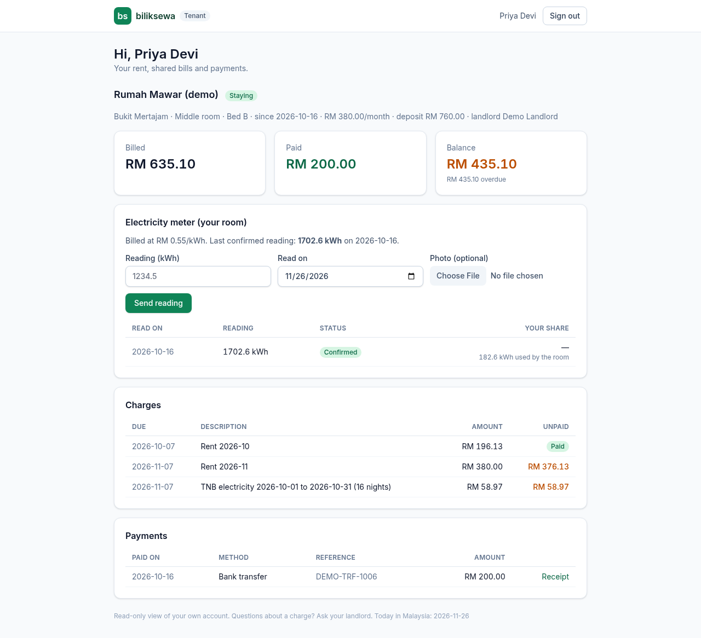

# biliksewa

[](https://github.com/guangyou0716/biliksewa/actions/workflows/ci.yml)

Room and bed rental management web system for Malaysian landlords ("bilik sewa" means a room for rent).
It tracks who sleeps in which bed, bills monthly rent pro-rated by nights, splits house bills by nights
stayed, and keeps a ledger per tenant.

**Live demo:** <https://biliksewa-demo.guangyou.workers.dev>. Sign in as the demo landlord
`demo@biliksewa.test` / `demo-landlord`, or as the demo tenant `tenant@biliksewa.test` / `demo-tenant`. All people, houses and payments in it are made up. Anyone can
change the demo data, and it goes back to the sample data every hour.


## Features

- **Properties, rooms and beds** on one board with occupancy; add rooms and beds.
- **Move in / move out** per bed. A bed can't have overlapping tenancies (the next tenant may start on the
  move-out day). A move-out recorded late corrects what was already billed: rent is re-pro-rated, and every
  split house bill whose period runs past the move-out is split again by the nights actually stayed, over
  the same tenants, so it still adds up to the sen (housemates' shares go up accordingly).
- **Deposit settlement** after move-out: up to 5 deductions (cleaning, repairs...) with a live preview.
  The deposit pays the deductions first, then any unpaid rent and bills (recorded as one "from deposit"
  payment that is not counted as cash collected), and the rest is the refund. Settled once per tenancy;
  the tenant sees the same breakdown in the portal.
- **Monthly rent** generated once per tenancy per month, pro-rated by nights. Running it twice does nothing;
  a partial unique index in the database enforces this too.
- **House bill split** (electricity, water, internet) by nights stayed, with a preview. Shares use the largest
  remainder method, so they add up to the bill exactly, to the sen. The same bill can't be split twice.
- **Tenant ledger**: charges, payments (recorded by hand, no payment gateway), balance and overdue amount.
  Payments are applied to the oldest charge first.
- **Dashboard**: occupancy, billed and collected this month, outstanding, and the overdue list.
- **Tenant portal**: the landlord creates a one-time invite link (valid 7 days, copy or share on WhatsApp).
  The tenant picks a password and then sees only their own stay, charges, payments and printable payment
  receipts. Landlord pages are closed to tenant accounts, and another tenant's receipt is a 404, the same as
  a receipt that doesn't exist. The landlord can remove access at any time, which signs the tenant out.
- **Sign-in security**: scrypt password hashes, server-side sessions that store only the SHA-256 of the token,
  14-day expiry, `Secure` cookies on HTTPS. Invite tokens are stored hashed too. Failed sign-ins are rate
  limited (5 per email from one address and 20 per address every 15 minutes; in memory, per process).
  Every landlord query is scoped to the signed-in landlord.





## Stack

SvelteKit (Svelte 5) + TypeScript, Drizzle ORM + SQLite, Tailwind CSS v4, Vitest, Playwright, GitHub Actions.
Money is stored as integer sen.

## Run locally

Needs Node.js 22 or later.

```sh
npm ci
cp .env.example .env    # sets DATABASE_URL=local.db
npm run db:seed         # resets local.db with the synthetic demo data
npm run dev
```

Open <http://localhost:5173> and sign in with one of the demo accounts above.

| Command                           | What it does                                          |
| --------------------------------- | ----------------------------------------------------- |
| `npm test`                        | unit and integration tests (Vitest, in-memory SQLite) |
| `npm run test:e2e`                | Playwright tests against the built app                |
| `npm run lint` / `npm run check`  | Prettier + ESLint / svelte-check                      |
| `npm run build` then `node build` | production build for Node (adapter-node)              |

## Public demo on Cloudflare

The demo runs on Cloudflare Workers' free plan. `npm run demo:build` builds the app with
`@sveltejs/adapter-cloudflare`, and [`worker/demo.ts`](worker/demo.ts) sends every request to one Durable
Object. That object keeps the data in its built-in SQLite storage. Its queries run synchronously like
better-sqlite3, so the app code is the same as on Node. The object seeds the synthetic data on first use and
wipes visitors' changes every hour, or straight away when a deploy adds a database migration. `npm run demo:dev` runs it locally; `npm run demo:deploy` deploys it with
the settings in [`wrangler.demo.jsonc`](wrangler.demo.jsonc).

## License

MIT
