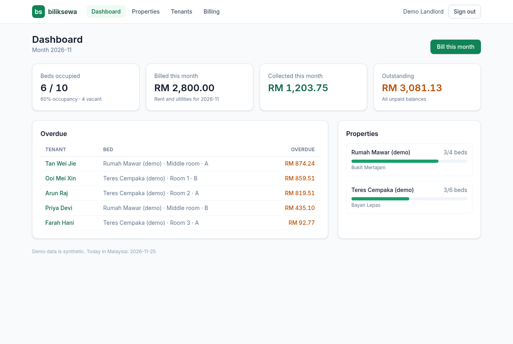
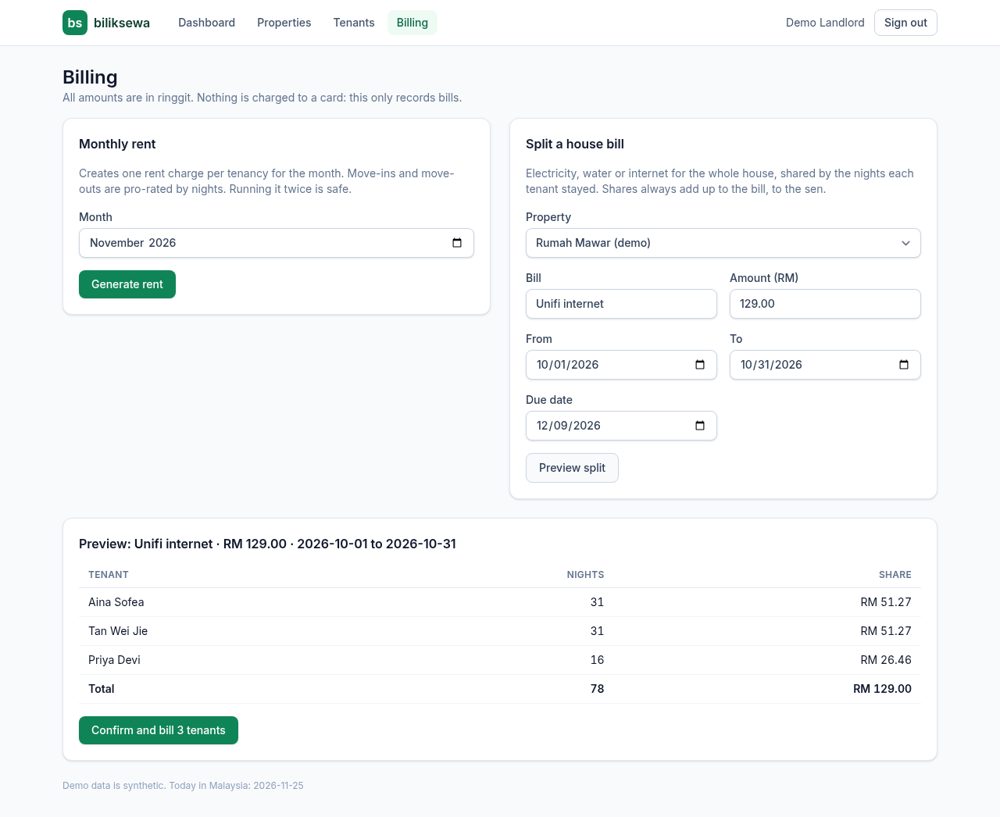

# biliksewa

[](https://github.com/guangyou0716/biliksewa/actions/workflows/ci.yml)

Room and bed rental management web system for Malaysian landlords ("bilik sewa" means a room for rent).
It tracks who sleeps in which bed, bills monthly rent pro-rated by nights, splits house bills by nights
stayed, and keeps a ledger per tenant.

**Live demo:** <https://biliksewa-demo.guangyou.workers.dev>. Sign in with the demo account
`demo@biliksewa.test` / `demo-landlord`. All people, houses and payments in it are made up. Anyone can
change the demo data, and it goes back to the sample data every hour.



## Features

- **Properties, rooms and beds** on one board with occupancy; add rooms and beds.
- **Move in / move out** per bed. A bed can't have overlapping tenancies (the next tenant may start on the
  move-out day). Moving out re-pro-rates rent that was already billed.
- **Monthly rent** generated once per tenancy per month, pro-rated by nights. Running it twice does nothing;
  a partial unique index in the database enforces this too.
- **House bill split** (electricity, water, internet) by nights stayed, with a preview. Shares use the largest
  remainder method, so they add up to the bill exactly, to the sen. The same bill can't be split twice.
- **Tenant ledger**: charges, payments (recorded by hand, no payment gateway), balance and overdue amount.
  Payments are applied to the oldest charge first.
- **Dashboard**: occupancy, billed and collected this month, outstanding, and the overdue list.
- **Landlord sign-in**: scrypt password hashes, server-side sessions that store only the SHA-256 of the token,
  14-day expiry, `Secure` cookies on HTTPS. Every query is scoped to the signed-in landlord.




## Stack

SvelteKit (Svelte 5) + TypeScript, Drizzle ORM + SQLite, Tailwind CSS v4, Vitest, Playwright, GitHub Actions.
Money is stored as integer sen.

## Run locally

Needs Node.js 22 or later.

```sh
npm ci
cp .env.example .env    # sets DATABASE_URL=local.db
npm run db:seed         # resets local.db with the synthetic demo data
npm run dev
```

Open <http://localhost:5173> and sign in with the demo account above.

| Command                           | What it does                                          |
| --------------------------------- | ----------------------------------------------------- |
| `npm test`                        | unit and integration tests (Vitest, in-memory SQLite) |
| `npm run test:e2e`                | Playwright tests against the built app                |
| `npm run lint` / `npm run check`  | Prettier + ESLint / svelte-check                      |
| `npm run build` then `node build` | production build for Node (adapter-node)              |

## Public demo on Cloudflare

The demo runs on Cloudflare Workers' free plan. `npm run demo:build` builds the app with
`@sveltejs/adapter-cloudflare`, and [`worker/demo.ts`](worker/demo.ts) sends every request to one Durable
Object. That object keeps the data in its built-in SQLite storage. Its queries run synchronously like
better-sqlite3, so the app code is the same as on Node. The object seeds the synthetic data on first use and
wipes visitors' changes every hour. `npm run demo:dev` runs it locally; `npm run demo:deploy` deploys it with
the settings in [`wrangler.demo.jsonc`](wrangler.demo.jsonc).

## License

MIT
