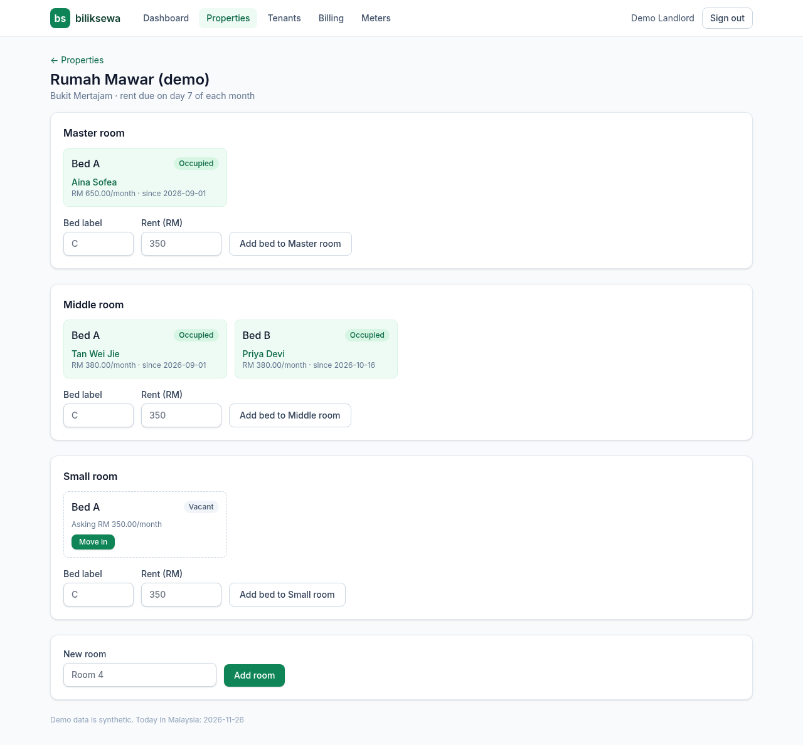
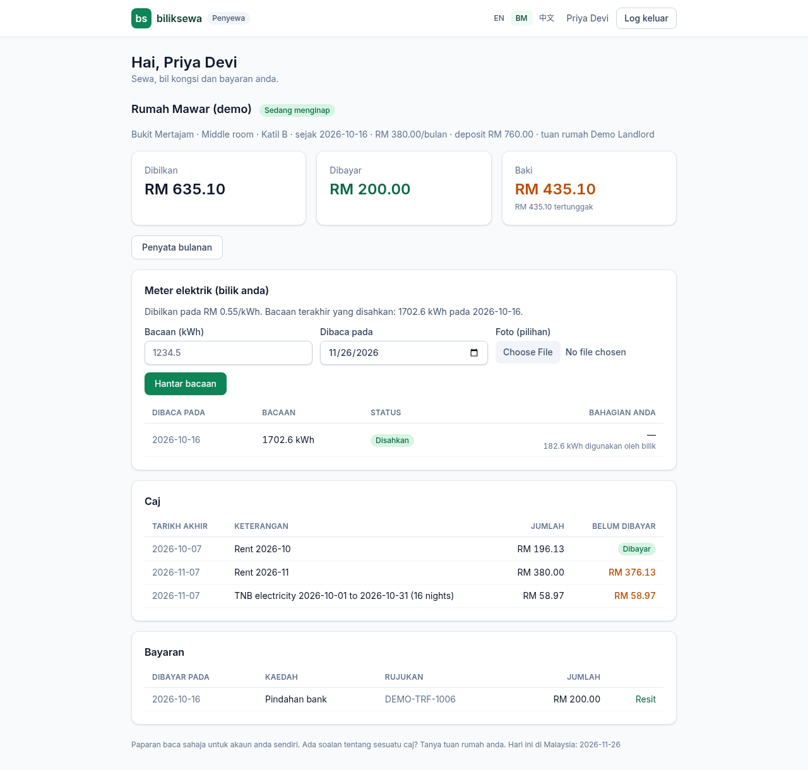
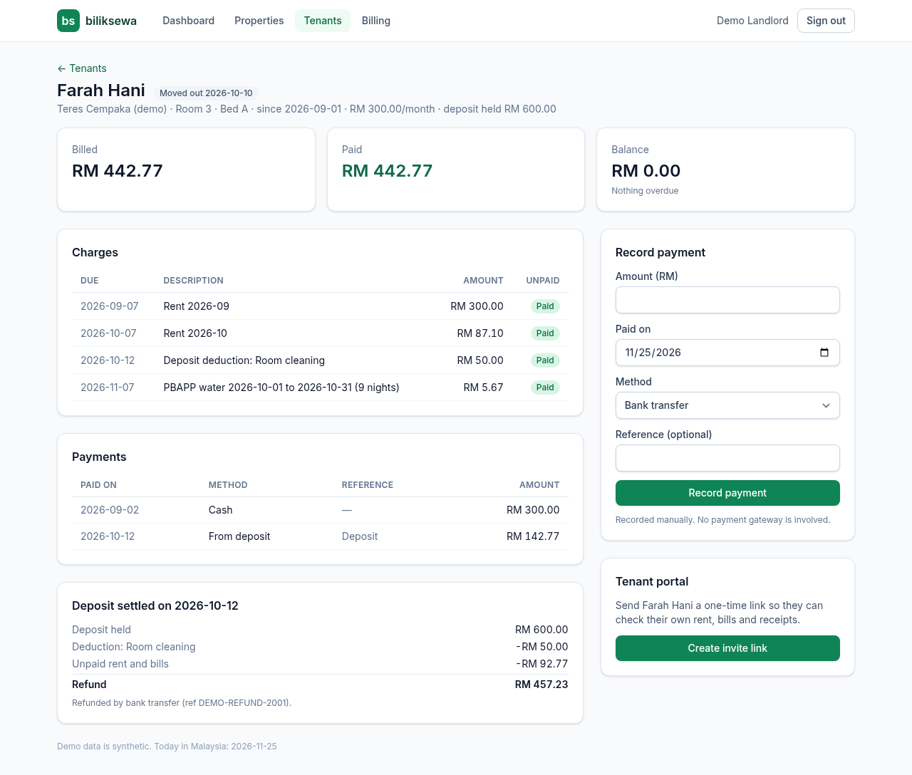
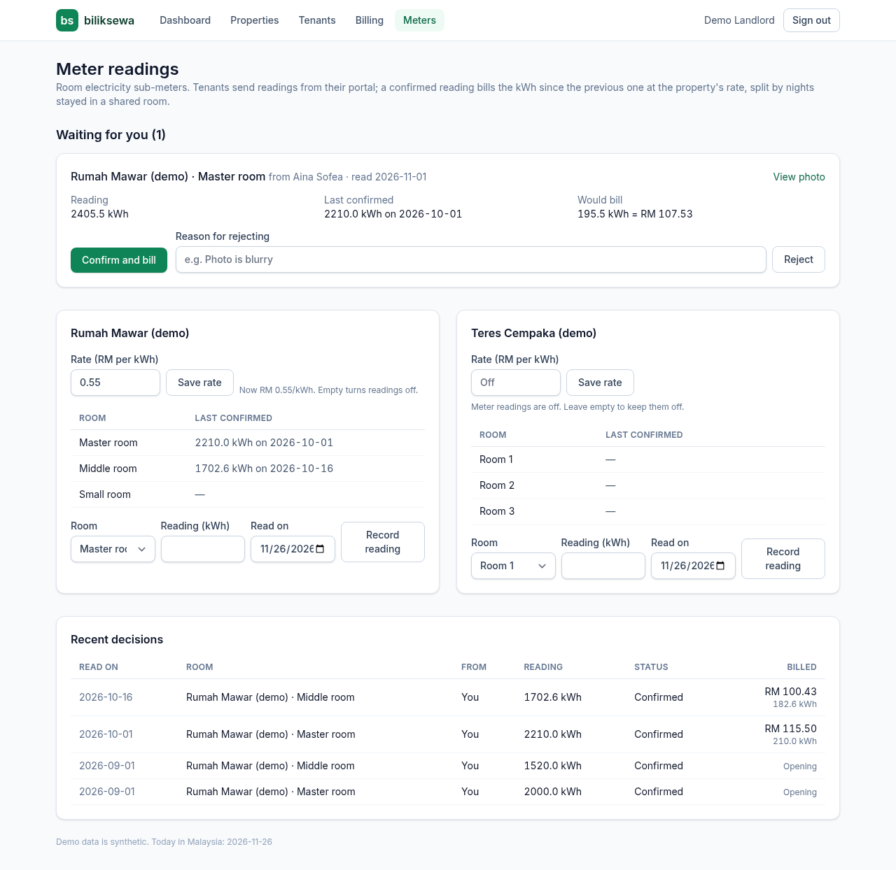
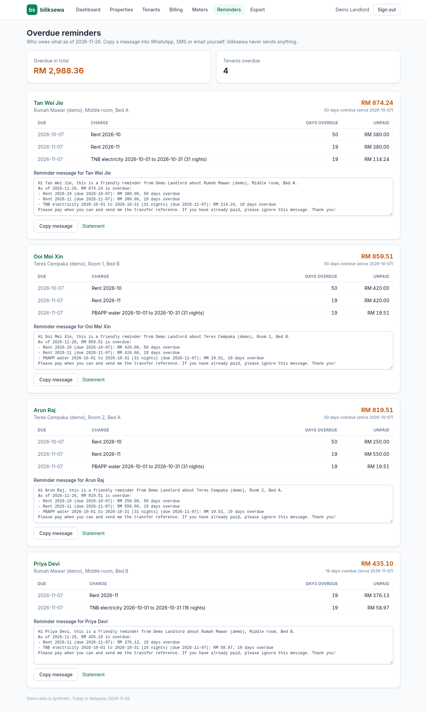
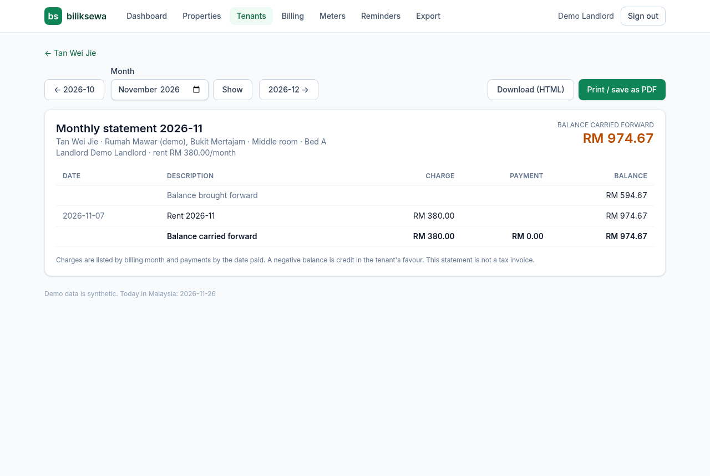

# biliksewa

[](https://github.com/guangyou0716/biliksewa/actions/workflows/ci.yml)

Room and bed rental management web system for Malaysian landlords ("bilik sewa" means a room for rent).
It tracks who sleeps in which bed, bills monthly rent pro-rated by nights, splits house bills by nights
stayed, and keeps a ledger per tenant.

**Live demo:** <https://biliksewa-demo.guangyou.workers.dev>. Sign in as the demo landlord
`demo@biliksewa.test` / `demo-landlord`, or as the demo tenant `tenant@biliksewa.test` / `demo-tenant`. All people, houses and payments in it are made up. Anyone can
change the demo data, and it goes back to the sample data every hour.


## Features

- **Properties, rooms and beds** on one board with occupancy; add rooms and beds.
- **Move in / move out** per bed. A bed can't have overlapping tenancies (the next tenant may start on the
  move-out day). A move-out recorded late corrects what was already billed: rent is re-pro-rated, and every
  split house bill whose period runs past the move-out is split again by the nights actually stayed, over
  the same tenants, so it still adds up to the sen (housemates' shares go up accordingly).
- **Deposit settlement** after move-out: up to 5 deductions (cleaning, repairs...) with a live preview.
  The deposit pays the deductions first, then any unpaid rent and bills (recorded as one "from deposit"
  payment that is not counted as cash collected), and the rest is the refund. Settled once per tenancy;
  the tenant sees the same breakdown in the portal.
- **Monthly rent** generated once per tenancy per month, pro-rated by nights. Running it twice does nothing;
  a partial unique index in the database enforces this too.
- **House bill split** (electricity, water, internet) by nights stayed, with a preview. Shares use the largest
  remainder method, so they add up to the bill exactly, to the sen. The same bill can't be split twice.
- **Room electricity sub-meters**: the landlord sets a rate per property (RM per kWh, up to 4 decimals).
  A tenant sends their room's meter reading from the portal, optionally with a photo; the landlord confirms
  it or rejects it with a reason the tenant sees. A confirmed reading bills the kWh used since the room's
  previous confirmed reading, rounded half up to the sen, and a shared room's charge is split by the nights
  each tenant stayed in that period (exact to the sen). A reading can't go below the last confirmed one,
  must be dated after it, and more than 60 kWh a day is refused as a likely typo. One reading waits per room
  at a time. The first confirmed reading of a room only opens it; the landlord can also record readings
  (e.g. at move-in). Tenants see their own submissions, the room's confirmed readings during their stay
  and only their own share. Photos are checked by their bytes (JPEG, PNG or WebP, max 300 KB; the browser
  shrinks phone photos first), stored in the database so the Cloudflare demo needs no extra storage, and
  served only to the tenant who sent them and the landlord.
- **Tenant ledger**: charges, payments (recorded by hand, no payment gateway), balance and overdue amount.
  Payments are applied to the oldest charge first.
- **Dashboard**: occupancy, billed and collected this month, outstanding, and the overdue list.
- **Receipts and monthly statements**: every payment has a printable receipt (`R-000123`) for both the
  landlord and the tenant. A monthly statement per tenancy shows the balance brought forward, the month's
  charges (by billing month) and payments (by date paid) with a running balance, and the balance carried
  forward. Print it or save it as PDF from the browser's print dialog (navigation is hidden in print), or
  download it as one self-contained HTML file (inline styles, no scripts, no external requests). There is
  no PDF library on purpose: the same code works on Node and in the Cloudflare Worker demo. Tenants open
  only their own statements; anything else is a 404.
- **CSV export** of charges (with what is still unpaid on each) and payments (with receipt numbers) for one
  month or all months, for Excel, Google Sheets or an accountant. Amounts are plain decimals from integer
  sen. Text cells starting with `=`, `+`, `-`, `@`, tab or carriage return (also after leading spaces, and
  the full-width `＝＋－＠`) are prefixed with `'` so a name like `=HYPERLINK(...)` can't run as a
  spreadsheet formula.
- **Overdue reminders**: who owes what, charge by charge, with days overdue (payments applied oldest first;
  moved-out tenants who still owe are included) and a ready-made polite reminder message to copy into
  WhatsApp, SMS or email, written in English, Bahasa Melayu or Simplified Chinese (pick the tenant's
  language per page, independent of your own). biliksewa never sends anything itself.
- **Three languages**: English, Bahasa Melayu and 简体中文. The EN / BM / 中文 picker in the header (and on
  the sign-in and invite pages) is a plain form, so it works without JavaScript; the choice is kept in a
  cookie for a year, and until then the browser's language is used. Every page is translated: sign-in,
  invite, all landlord pages (dashboard, properties, tenants, billing, meters, reminders including the
  message text, export), the whole tenant portal (ledger, meter readings, deposit, statements, receipts, the
  downloaded statement file), and the server's form validation and success messages ("Rent: enter an
  amount like 450", "Payment of RM 100.00 recorded"), with the field name translated too. Names and charge
  descriptions are shown as entered. A unit test checks that every language has every message with the
  same placeholders, and validation errors carry a message key, so a missing translation fails the build.
- **Accessibility**: every page is audited with axe-core (WCAG 2.1 A/AA rules) in the Playwright tests, in
  English, Bahasa Melayu and Chinese for the public and landlord pages, and English and Chinese for the
  portal; `<html lang>` follows the chosen language.
- **Tenant portal**: the landlord creates a one-time invite link (valid 7 days, copy or share on WhatsApp).
  The tenant picks a password and then sees only their own stay, charges, payments and printable payment
  receipts. Landlord pages are closed to tenant accounts, and another tenant's receipt is a 404, the same as
  a receipt that doesn't exist. The landlord can remove access at any time, which signs the tenant out.
- **Sign-in security**: scrypt password hashes, server-side sessions that store only the SHA-256 of the token,
  14-day expiry, `Secure` cookies on HTTPS. Invite tokens are stored hashed too. Failed sign-ins are rate
  limited (5 per email from one address and 20 per address every 15 minutes; in memory, per process).
  Every landlord query is scoped to the signed-in landlord.










## Stack

SvelteKit (Svelte 5) + TypeScript, Drizzle ORM + SQLite, Tailwind CSS v4, Vitest, Playwright + axe-core,
Docker, GitHub Actions. Translations are plain TypeScript objects (no i18n library). Money is stored as
integer sen.

## Run locally

Needs Node.js 22 or later.

```sh
npm ci
cp .env.example .env    # sets DATABASE_URL=local.db
npm run db:seed         # resets local.db with the synthetic demo data
npm run dev
```

Open <http://localhost:5173> and sign in with one of the demo accounts above.

| Command                           | What it does                                          |
| --------------------------------- | ----------------------------------------------------- |
| `npm test`                        | unit and integration tests (Vitest, in-memory SQLite) |
| `npm run test:e2e`                | Playwright tests (incl. axe audit) on the built app   |
| `npm run lint` / `npm run check`  | Prettier + ESLint / svelte-check                      |
| `npm run build` then `node build` | production build for Node (adapter-node)              |

## Run with Docker

The image runs the Node build (adapter-node) as a non-root user with the SQLite database on a named
volume; migrations are applied on start.

```sh
docker compose up -d --build    # http://localhost:3000
docker compose logs -f app
docker compose down             # add -v to delete the database volume
```

On first start with an empty volume it fills in the synthetic demo accounts above
(`BILIKSEWA_SEED_DEMO=1`, the default in `docker-compose.yml`); an existing database is never touched.
For real use set `BILIKSEWA_SEED_DEMO=0`, and set `BILIKSEWA_ORIGIN` to the address people open (for
example `https://sewa.example.com` behind a TLS proxy), because SvelteKit checks it on form posts. CI
builds the image, starts it and signs in to the seeded demo on every push.

## Public demo on Cloudflare

The demo runs on Cloudflare Workers' free plan. `npm run demo:build` builds the app with
`@sveltejs/adapter-cloudflare`, and [`worker/demo.ts`](worker/demo.ts) sends every request to one Durable
Object. That object keeps the data in its built-in SQLite storage. Its queries run synchronously like
better-sqlite3, so the app code is the same as on Node. The object seeds the synthetic data on first use and
wipes visitors' changes every hour, or straight away when a deploy adds a database migration. `npm run demo:dev` runs it locally; `npm run demo:deploy` deploys it with
the settings in [`wrangler.demo.jsonc`](wrangler.demo.jsonc).

## License

MIT
